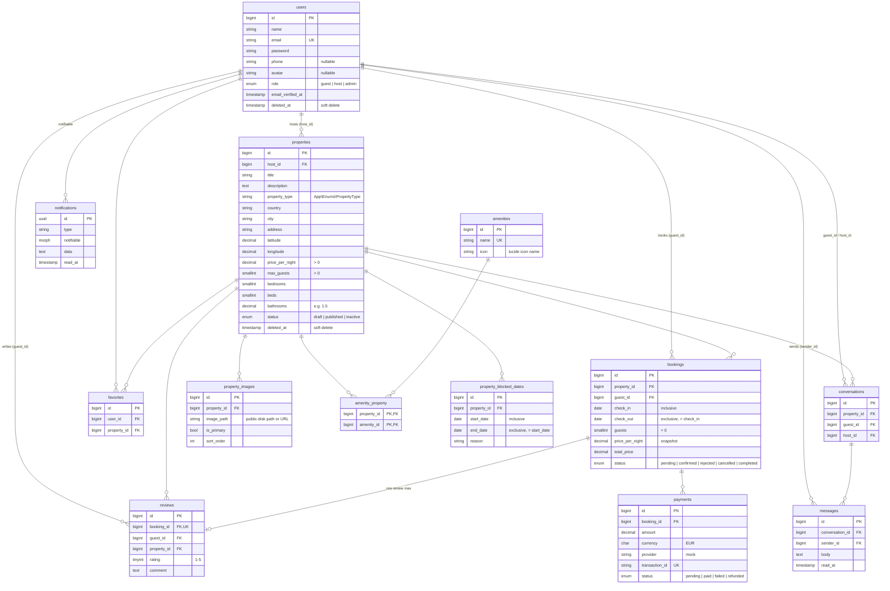

# Database

MySQL 8.4, database `airbnb_clone` (tests use `airbnb_clone_testing`).

**Laravel migrations in [`backend/database/migrations`](../backend/database/migrations) are the source of truth.** The original `schema.sql` was converted into them and is no longer used. To change the schema, add a new migration; never edit one that is already on `main`.

## Entity–relationship diagram



All tables also have `created_at` / `updated_at`. Laravel's own tables (`sessions`, `password_reset_tokens`, `cache`, `jobs`, `failed_jobs`, `personal_access_tokens`, …) are not shown.

## Rules every developer should know

### Dates: check-out is exclusive
`check_in`/`start_date` are the first night, `check_out`/`end_date` is the departure day and is **not** occupied. A stay 10→15 March is 5 nights, and the next guest may arrive on 15 March.

Two ranges overlap when `existing.start < new.end AND existing.end > new.start`. That's implemented once in `Property::availableBetween($checkIn, $checkOut)`; use it instead of writing your own query:

```php
Property::published()->availableBetween('2027-03-10', '2027-03-15')->get();
```

Only `pending` and `confirmed` bookings block dates (`BookingStatus::blocksDates()`), plus host-blocked ranges in `property_blocked_dates`.

### Creating a booking: lock to prevent double booking
MySQL can't enforce "no overlapping bookings" by itself. Two people clicking "Book" at the same moment would both pass a plain availability check. Lock the property row inside a transaction:

```php
use Illuminate\Support\Carbon;
use Illuminate\Support\Facades\DB;

$booking = DB::transaction(function () use ($property, $data, $user) {
    // Concurrent requests for the same listing wait here until the first one commits
    Property::whereKey($property->id)->lockForUpdate()->first();

    $isFree = Property::whereKey($property->id)
        ->availableBetween($data['check_in'], $data['check_out'])
        ->exists();
    abort_unless($isFree, 422, 'These dates are no longer available.');

    $nights = Carbon::parse($data['check_in'])->diffInDays($data['check_out']);

    return $property->bookings()->create([
        'guest_id' => $user->id,
        'check_in' => $data['check_in'],
        'check_out' => $data['check_out'],
        'guests' => $data['guests'],
        'price_per_night' => $property->price_per_night,          // snapshot
        'total_price' => $property->price_per_night * $nights,
    ]);
});
```

Also validate `guests <= $property->max_guests` and that the listing is `published`.

### Deleting things
- `users` and `properties` use **soft deletes** (`$model->delete()` sets `deleted_at`). Their bookings, reviews and payments stay intact. Soft-deleted rows are hidden from queries automatically.
- Bookings, reviews and payments are **never deleted** (`RESTRICT` foreign keys): change their `status` instead (`cancelled`, `refunded`, …).
- Images, amenity links, favourites, blocked dates, conversations and messages are deleted together with their parent (`CASCADE`).

### Copied columns
Some IDs are copied on purpose so common queries need no join. The code creating the row must copy them:
- `reviews.guest_id` / `reviews.property_id` ← from the booking.
- `conversations.host_id` ← from the property.

### Enums
Allowed values live in `backend/app/Enums` and are cast on the models (`$booking->status === BookingStatus::Confirmed`). Validate requests with `Rule::enum(PropertyType::class)`. `property_type` is a string column so a new type only needs a new enum case; the other enums are MySQL `ENUM` columns and need a migration to add values.

### Security
`users.role` is **not** mass-assignable, so a registration request can't send `role=admin`. Set it explicitly: `$user->role = UserRole::Host; $user->save();`.

### Money
`DECIMAL(10,2)`, currency `EUR` by default. Payments use the `mock` provider until a real one is chosen.

### Images
`property_images.image_path` is a path on the `public` disk (`$request->file('photo')->store("properties/{$id}", 'public')`). Use the model's `url` attribute in API responses. Seeded images are full picsum.photos URLs and `url` returns them as-is.

### Notifications
Laravel's built-in table. Use `$user->notify(new BookingConfirmed($booking))` with the `database` (and `mail`) channel; read with `$user->unreadNotifications`.

### Messaging
Inbox for a user: `$user->guestConversations()` / `$user->hostConversations()`, ordered by `updated_at` (each new message bumps it). `latestMessage` gives the preview line.

## Database protections (CHECK constraints)
Enforced by MySQL even if validation is forgotten (see `backend/tests/Feature/Database/ConstraintsTest.php`):

| Table | Rule |
|---|---|
| properties | `price_per_night > 0`, `max_guests > 0`, `bathrooms >= 0`, valid latitude/longitude |
| bookings | `check_out > check_in`, `guests > 0`, prices `>= 0` |
| property_blocked_dates | `end_date > start_date` |
| reviews | `rating BETWEEN 1 AND 5`, one review per booking |
| payments | `amount >= 0`, unique `transaction_id` |
| favorites | one row per user + property |
| conversations | one thread per guest + property |

## Changes from the original schema.sql

| Change | Why |
|---|---|
| Raw SQL → Laravel migrations + seeders | Versioned with the code; every dev gets the same schema with `php artisan migrate`. |
| Added `remember_token`, Laravel framework tables, Sanctum tokens | Needed by Laravel auth, sessions, cache, queues and API tokens. |
| Custom `notifications` → Laravel's standard table | Same table name, incompatible shape; Laravel's gives `notify()` / `unreadNotifications` for free. |
| Soft deletes on `users` and `properties` | With RESTRICT keys, anyone with a booking could never be deleted. |
| `user_id` → `host_id` / `guest_id` | Bookings and messages involve two users; explicit names avoid mix-ups. |
| `property_amenities` → `amenity_property` | Laravel's pivot naming convention, no extra config in `belongsToMany`. |
| Removed `bookings.nights` | Always equal to `check_out - check_in`; computed by the model instead. |
| Added `bookings.price_per_night` | Price snapshot; the host can change the listing price later. |
| Added `rejected` booking status | A host can decline a pending request (different from a cancellation). |
| `favorites.updated_at` added | Required by Laravel's `withTimestamps()`. |
| `bathrooms` → `DECIMAL(3,1)` | Allows 1.5 bathrooms. |
| `role`, `status`, `currency` → `NOT NULL` | They had defaults but allowed NULL. |
| Extra CHECKs (bathrooms, coordinates, booking prices) | Cheap protection against bad data. |
| New: `property_blocked_dates`, `conversations`, `messages` | Host calendar blocking and guest–host messaging. |
